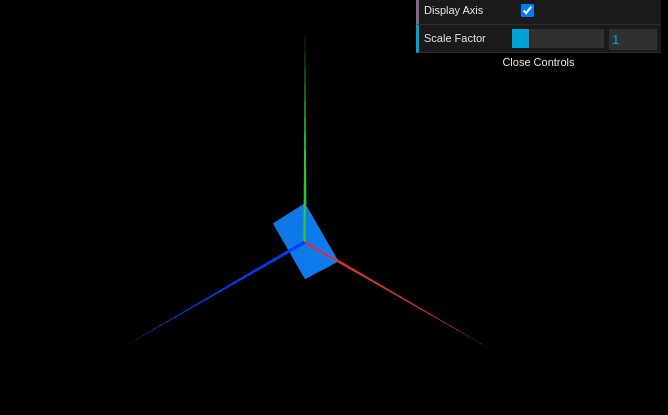
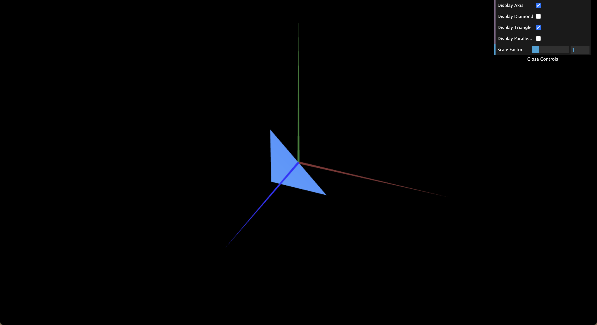
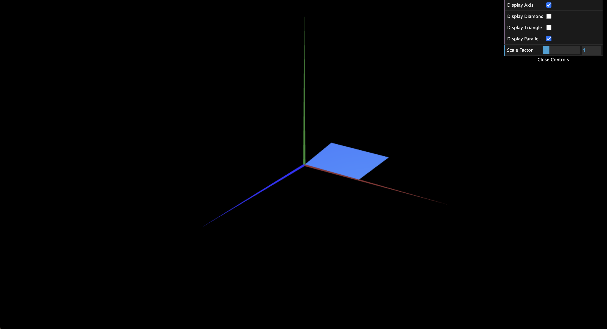
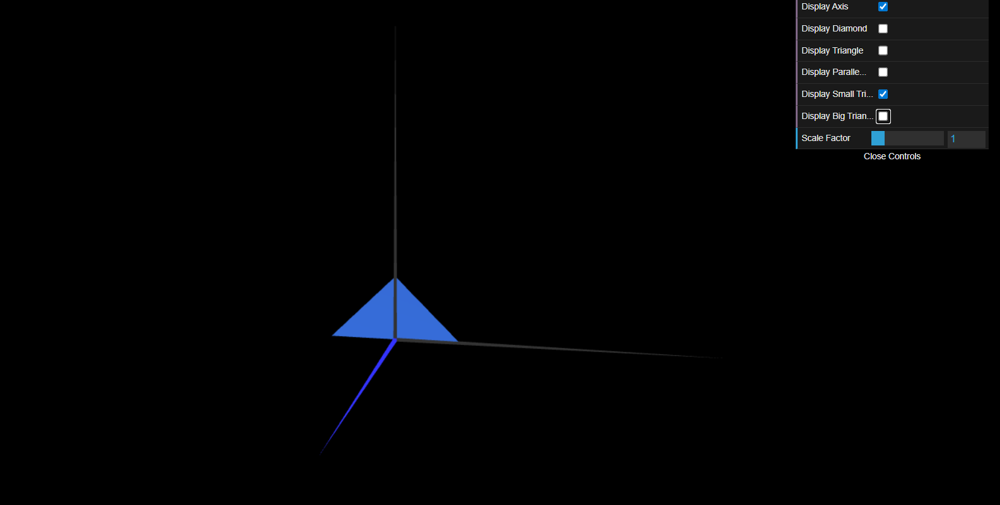
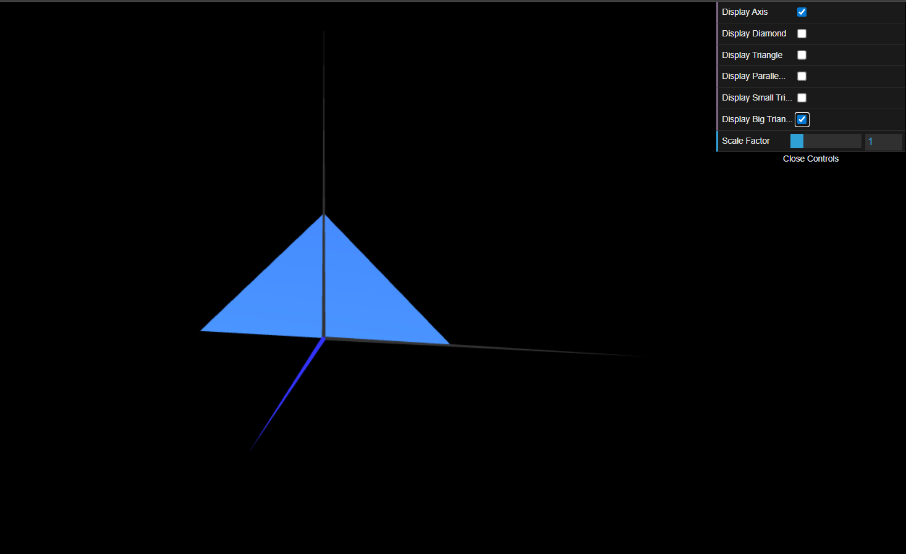

# CG 2025/2026

## Group T05G08

## TP 1 Notes

- In exercise 1.1 we created the `MyTriangle` class following the `MyDiamond` example, defining a right triangle. We observed that vertex order (counter-clockwise) is critical for the face to be visible due to back-face culling.
- In exercise 1.2 we added two checkboxes to `MyInterface` to toggle the visibility of the diamond and the triangle independently, by binding boolean flags in `MyScene` to `dat.GUI` controls.
- In exercise 1.3 we created `MyParallelogram` with a leftmost vertex at the origin. To make it double-sided we duplicated the indices in reverse winding order, since setting would otherwise hide one side.
- In exercise 1.4 we added a third checkbox to control the visibility of the parallelogram, following the same pattern used for the diamond and triangle.

### Exercise 2

In this exercise, we created 2 classes: `MyTriangleSmall` and `MyTriangleBig`.

__MyTriangleSmall__

This class, instead of defining a right triangle, such as created on the `MyTriangle` class, defines an isosceles triangle centered at the origin. In order to do that, we simply assigned the vertex positions of the triangle in order to display the image in the right shape and place. Every other thing was exactly as in the `MyTriangle` class.

__MyTriangleBig__

This class, just as in the `MyTriangleSmall` class, defines an isosceles triangle centered at the origin, but with twice the size of smaller one.
In order to do that, we decided to simply extend the `MyTriangleSmall` class instead of rewriting the same logic.Then, we override the `display` function and applied a scale factor with vector (2,2,1), which duplicates the triangle size in the x and y axis.

In order to do it, we called the following functions:
* `scene.pushMatrix`: saves the current transformation matrix of the scene (to be restored later).
* `scene.scale`: scales the scene by x,y and z values, in this case x=2, y=2, z=1 (not needed).
* `super.display`: applies the current transformations (like the scale) to the object, and draws it in the scene.
* `scene.popMatrix`: restores the previously saved transformation matrix. 

 