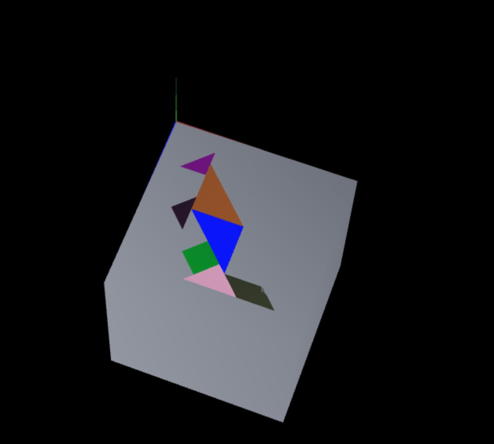

# CG 2025/2026

## Group T05G08

## TP 2 Notes

---

### Exercise 1 – MyTangram Composition

In this exercise, we combined all previously created objects into a single **composite object**, `MyTangram`, to recreate the Tangram figure.

#### MyTangram Class

* `MyTangram` extends `CGFobject` and holds instances of all Tangram pieces.
* Each piece is displayed in the correct position according to our assigned figure using **geometric transformations** relative to the origin `(0,0,0)`.
* We used `scene.pushMatrix()` and `scene.popMatrix()` to isolate transformations per piece, preventing one piece's translation or rotation from affecting the others.

The exercise itself was straightforward in terms of transformations.

---

### Exercise 2 – MyUnitCube

In this exercise, we implemented a **unit cube** centered at the origin using a single triangle mesh.

#### MyUnitCube Class

The class `MyUnitCube` extends `CGFobject` and defines:

* 8 vertices (from `-0.5` to `0.5`)
* 12 triangles (2 per face × 6 faces)
* A single indexed mesh

The cube is centered at the origin `(0,0,0)`.

At this stage, we had the **unit cube centered at the origin**.

#### Positioning the Cube as Tangram Base

The cube was then transformed to act as a base behind the Tangram.

We applied geometric transformations to:

* Scale the cube to resemble a flat base
* Translate it so it sits behind the Tangram
* Rotate the entire Tangram + base set

Finally, we rotated the complete composition so that it became **parallel to the XZ plane**, positioning the top-left vertex of the base at the origin `(0,0,0)`.

### Final Result

* The Tangram composition
* A cube acting as a base
* The full structure aligned parallel to the XZ plane

