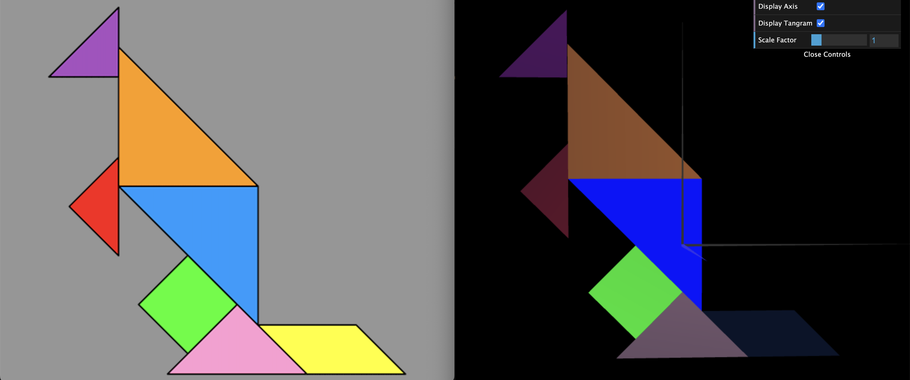

# CG 2025/2026

## Group T05G08
## TP 2 Notes

### Exercise 1 – MyTangram Composition

In this exercise, we combined all previously created objects into a single **composite object**, `MyTangram`, to recreate the Tangram figure.

#### MyTangram Class

* `MyTangram` extends `CGFobject` and holds instances of all Tangram pieces.
* Each piece is displayed in the correct position according to our group assigned picture using **geometric transformations** relative to the origin `(0,0,0)`.

* We used `scene.pushMatrix()` and `scene.popMatrix()` to isolate transformations per piece, preventing one piece's translation or rotation from affecting the others.

The exercise itself was straightforward in terms of transformations.

