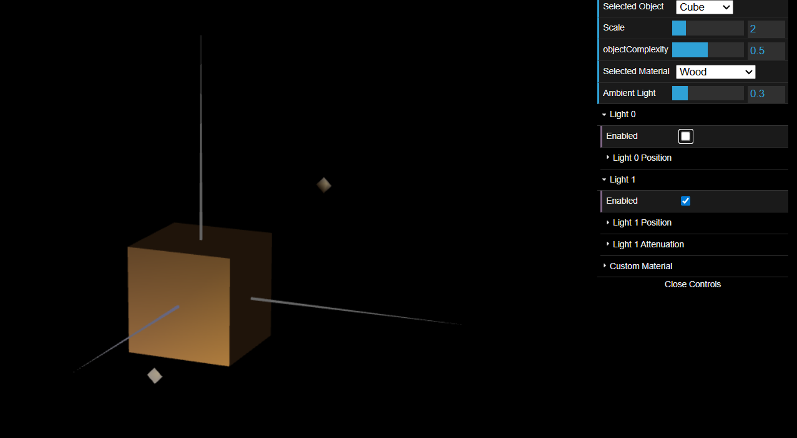
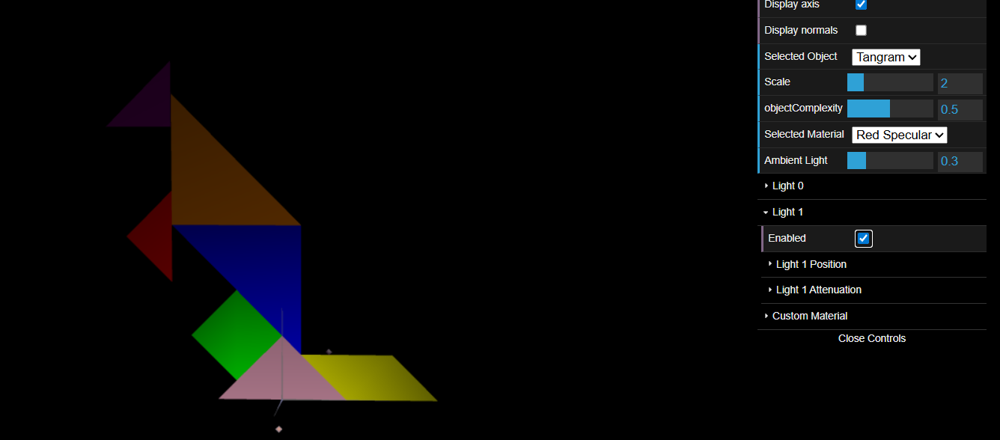
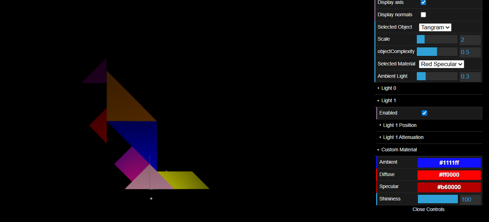

# CG 2025/2026

## Group T05G08

## TP 3 Notes

---

### Exercise 1 – Tangram's Ilumination and Materials 

In this exercise, we reused the MyUnitCube object and the Tangram object and all its component objects from TP2.

We added the Tangram and Cube objects to the scene objects list so they could be displayed on the scene.

After looking at the normals displayed by both Cube and Tangram, we concluded that these figures only had the 
default normals created (1,1,1) for each vertice which influence the lighting display on the figure.

The next goal was adding normals to both objects so the lighting would be displayed more accurately.

Starting from the Cube, our last implementation only needed 8 vertices, one for each cube vertice. However, since we wanted to have a smoother display, we would need 3 normals for each vertice. 

This meant that we had to define each vertex 3 times.

Then we added the normal vectors.

After that, we defined a material with similar color to wood and add it to the scene materials.

We tested it using the Cube just like as can be seen bellow:

For the Tangram object, the procedure was similar excepting the fact that tangram was only a 2D figure, which means that it only needed 2 normals (front and back) for each vertex.

In order to do that, we duplicated all vertices from the objects that compose the Tangram and and added the missing normals.

After that, we overrode enableNormalViz() and disableNormalViz() methods on Tangram object so the normals could be seen on the scene when the display normals option was on.

Then, we created a new material for each Tangram piece with the same colors as in the reference image we used to draw it.

Finally, we changed the MyDiamond object on the Tangram to use the material set as the custom material in the scene.

