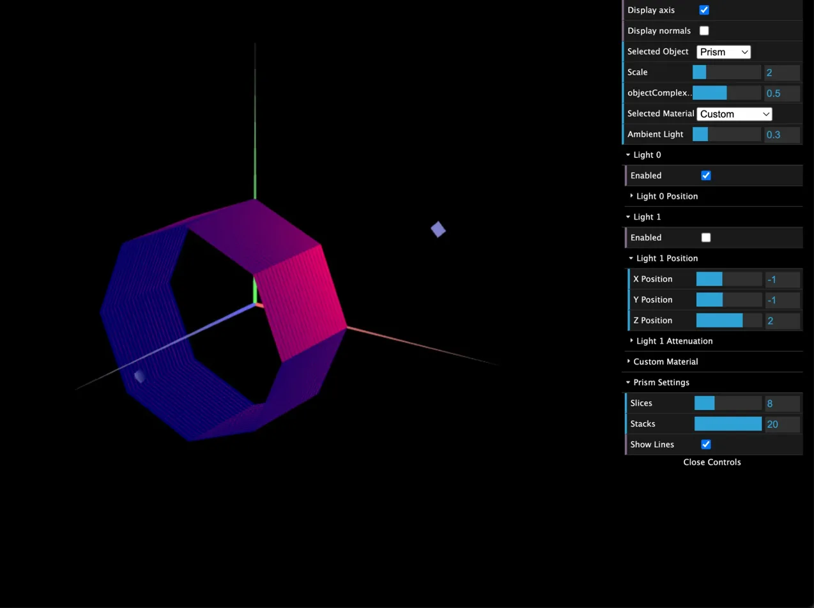
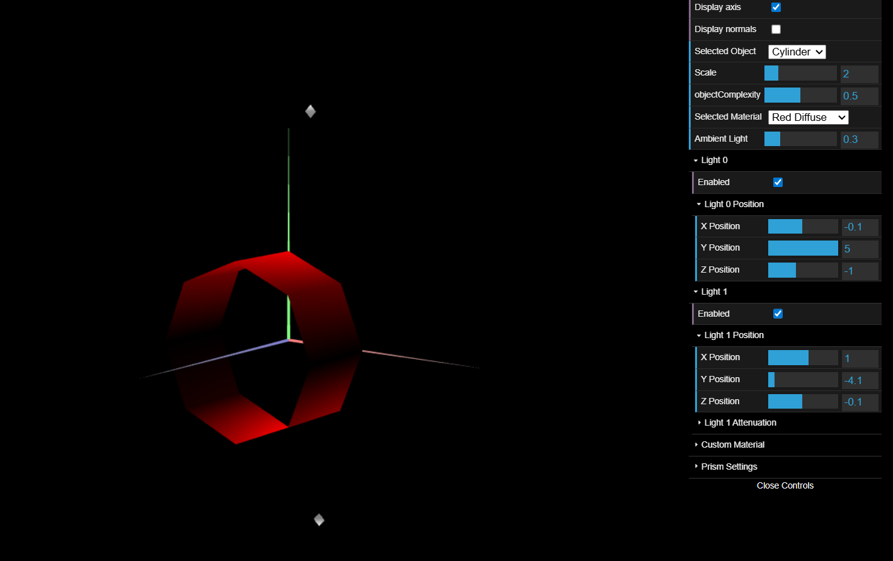
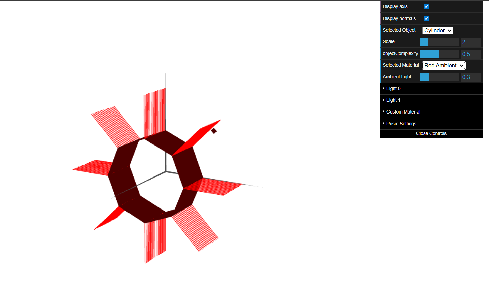

# CG 2025/2026

## Group T05G08

## TP 3 Notes

---

### Exercise 1 – Tangram's Ilumination and Materials 

In this exercise, we reused the MyUnitCube object and the Tangram object and all its component objects from TP2.

We added the Tangram and Cube objects to the scene objects list so they could be displayed on the scene.

After looking at the normals displayed by both Cube and Tangram, we concluded that these figures only had the 
default normals created (1,1,1) for each vertice which influence the lighting display on the figure.

The next goal was adding normals to both objects so the lighting would be displayed more accurately.

Starting from the Cube, our last implementation only needed 8 vertices, one for each cube vertice. However, since we wanted to have a smoother display, we would need 3 normals for each vertice. 

This meant that we had to define each vertex 3 times.

Then we added the normal vectors.

After that, we defined a material with similar color to wood and add it to the scene materials.

We tested it using the Cube just like as can be seen bellow:

For the Tangram object, the procedure was similar excepting the fact that tangram was only a 2D figure, which means that it only needed 2 normals (front and back) for each vertex.

In order to do that, we duplicated all vertices from the objects that compose the Tangram and and added the missing normals.

After that, we overrode enableNormalViz() and disableNormalViz() methods on Tangram object so the normals could be seen on the scene when the display normals option was on.

Then, we created a new material for each Tangram piece with the same colors as in the reference image we used to draw it.

Finally, we changed the MyDiamond object on the Tangram to use the material set as the custom material in the scene.

### Exercise 2 – Prism Drawing

In this exercise, we created a new `MyPrism.js` object capable of drawing a prism with a variable number of sides (slices) and floors (stacks), inscribed in a unit cylinder centered at the origin, with its base on the XY plane and unit length along the Z axis.

#### Part 1 – Single Stack

In a first version, we implemented the prism with only one stack (floor). Since each rectangular face of the prism must have normals perpendicular to that face (flat shading), we had to define each vertex more than once in the vertex list.

The normal for each face was computed as the outward-facing vector perpendicular to the face, lying on the XY plane, pointing away from the central Z axis. All normals were normalized.

We noted that, with this definition of normals (one constant normal per face), the resulting illumination is equivalent to Constant Shading.
#### Part 2 – Integration into MyScene

We imported `MyPrism.js` into `MyScene` and hid all previously displayed scene elements (except the axes). In the `init` function, we instantiated a `MyPrism` with 8 slices, representing a vertical column with appropriate dimensions. In the `display` function, we used scale and translation transformations to position and size the prism correctly before calling its `display` method.

#### Part 3 – Multiple Stacks

We extended the implementation to support multiple stacks, dividing the unit-height cylinder into equal vertical segments. The column from Part 2 was updated to use 20 stacks while keeping 8 slices and the same overall height. This results in a smoother appearance when lighting is applied, since each rectangular face is subdivided into smaller quads and the Gouraud interpolation produces more gradual shading transitions across the surface.

We added stack lines soo we can be able to see if the stacks are correct and added to the GUI.

### Exercise 3 – Cylindrical Surface - Application of Gouraud shading

In this exercise, we created a new MyCylinder object, which was similar to the prism implementation, and added the correct normals to smooth the cylinder's shading.

In order to do that, we decided to only define one normal on each vertex perpendicular to the face it belongs to. This means that the normal vector is equal to the vertex position itself.

Since we didn't need 2 normals for each vertex, contrary to MyPrism, we halved the vertex count.

In order to do that, we first defined all the vertices and normals needed to compose the Cylinder and then assigned the indices for all faces.

