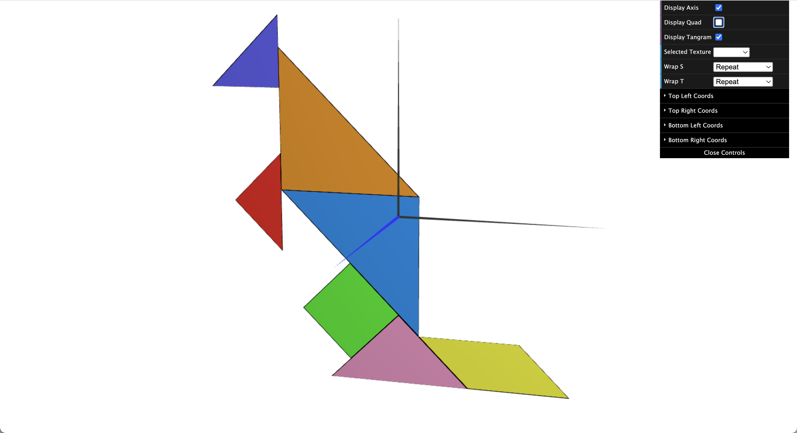

# CG 2025/2026

## Group T05G08

## TP 4 Notes

---

### Exercise 1: Applying Textures to the Tangram


#### Description

This exercise consists of applying a single texture (`tangram.png`) to the seven Tangram pieces, so that each piece displays the region of the image that corresponds to it. The UV mapping for each piece is calculated manually based on the normalized coordinates [0.0, 1.0] of the image.


### 1. Checkbox to hide MyQuad

A checkbox was added to the interface (dat.GUI) that allows hiding the `MyQuad` object and its `quadMaterial`, leaving the scene empty. The logic is controlled by a boolean variable in the scene's configuration object.

### 2. Texture materials for each piece

A `CGFappearance` with the `tangram.png` texture loaded was created for each piece. The materials are initialized in `initMaterials()` in the `MyTangram` class and applied individually in each draw method.


#### Biggest Difficulty

The biggest challenge of this exercise was **mapping different textures to two pieces that share the same object instance**.

The small red and purple triangles are both drawn through the same instance of `MyTriangleSmall`. Likewise, the large blue and orange triangles share the same instance of `MyTriangleBig`.

**The problem:** defining `this.texCoords` only once in `initBuffers()` means both pieces would always use the same coordinates, making it impossible to give each one its correct region of the texture.

#### Solution: `updateTexCoords()` per draw call

The solution was to add an `updateTexCoords(coords)` method to `MyTriangleSmall` (and by inheritance to `MyTriangleBig`) that updates the GPU buffers immediately before each draw call:

```js
updateTexCoords(coords) {
    this.texCoords = coords;
    this.updateTexCoordsGLBuffers();
}
```

This method is called in `MyTangram` inside each draw function, **immediately before `display()`**, updating the UV buffer on the GPU for that specific piece:

```js
redTriangle() {
    this.scene.pushMatrix();
    this.redMaterial.apply();
    this.triangleSmall.updateTexCoords([
        0.25, 0.5,
        0.5,  0.5,
        0.25, 0.25,
        // ... back face
    ]);

    this.triangleSmall.display();
    this.scene.popMatrix();
}
```

This way, each draw call receives its own UV coordinates, even though both use the same underlying WebGL object.

Final Result:

