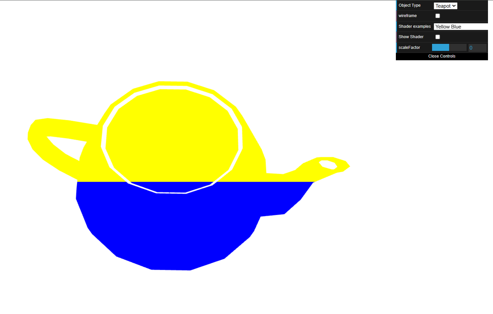
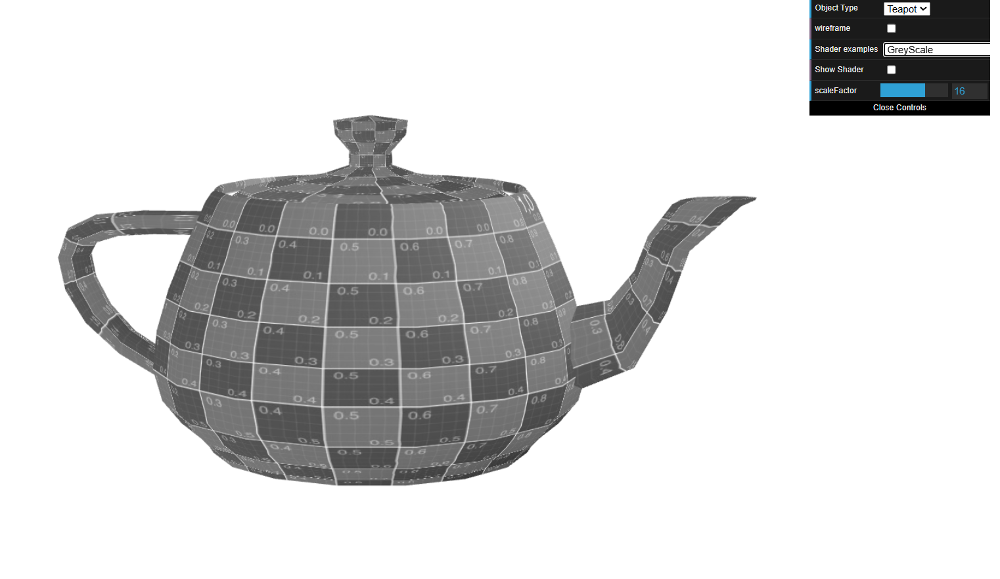
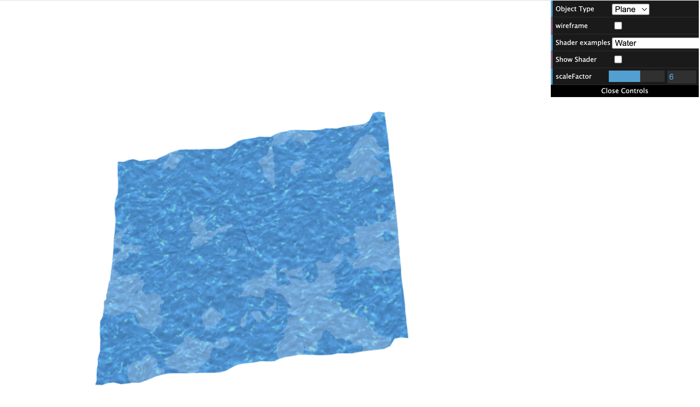

# CG 2025/2026

## Group T05G08

## TP 5 Notes

---

### Exercise 1: Shaders

#### 1.1 - Teapot Color Shader (Yellow/Blue by Position)

Created new vertex and fragment shaders to color the teapot based on the fragment's position in the window: yellow on the top half, blue on the bottom half. 

```
new CGFshader(this.gl, "shaders/yellowblue.vert", "shaders/yellowblue.frag"),
```

A `varying` variable was added to the vertex shader to pass `gl_Position` to the fragment shader, which then applies yellow if `y > 0.5` and blue otherwise.

``` js
 if(coords.y > 0.5){
    gl_FragColor =  normal;
    gl_FragColor.rgb = vec3(1.0, 1.0, 0.0); // yellow
}
else{
    gl_FragColor =  normal;
    gl_FragColor.rgb = vec3(0.0, 0.0, 1.0); //blue
}
```


#### 1.2 - Animation Shader: Sinusoidal Translation on X Axis

Modified the animation shader to produce a back-and-forth translation effect along the X axis following a sinusoidal wave. The translation amplitude is controlled by the `scaleFactor` from the interface, applied as an offset to `aVertexPosition` in the vertex shader.

``` js
vec3 translation = vec3(sin(timeFactor) * normScale, 0.0, 0.0);
	
gl_Position = uPMatrix * uMVMatrix * vec4(aVertexPosition+offset+translation, 1.0);
```

#### 1.3 - Grayscale Fragment Shader

Created a new fragment shader based on the Sepia shader that converts colors to grayscale. Each RGB component is replaced by the luminance value `L = 0.299R + 0.587G + 0.114B`.

``` js
vec4 colorSepia = color;
colorSepia.r = color.r * 0.299 + color.g *0.587 + color.b * 0.114;
colorSepia.g = color.r * 0.299 + color.g *0.587 + color.b * 0.114;
colorSepia.b = color.r * 0.299 + color.g *0.587 + color.b * 0.114;

gl_FragColor = colorSepia;
```




### Exercise 2: Shaders – Water Effect on Plane

#### Description

This exercise consists of creating two GLSL shaders (`water.vert` and `water.frag`) 
based on the existing `texture2.vert` and `texture2.frag` examples, and using them 
to simulate an animated water surface on the `MyPlane` object.


#### 1. Creating and Registering the Water Shaders

Two new shader files were created (`water.vert` and `water.frag`) based on 
`texture2.vert` and `texture2.frag`. They were registered in `ShaderScene.js` 
by adding a new entry to the `testShaders` array and exposing it in the 
`shadersList` object so it appears in the dat.GUI interface under the name 
**"Water"**.

The shader uses two texture samplers:
| Uniform | Texture Unit | Texture |
|---|---|---|
| `uSampler` | 0 | `waterTex.jpg` |
| `uSampler2` | 1 | `waterMap.jpg` |


#### 2. Replacing Textures and Dark Patches Effect

The default scene textures (`texture.jpg` and `FEUP.jpg`) are swapped for 
`waterTex.jpg` and `waterMap.jpg` when the Water shader is active. This is 
handled in the `display()` method of `ShaderScene.js`:

```js
if (this.selectedExampleShader == 11) {
    this.appearance.setTexture(this.waterTexture);
    this.waterMap.bind(1);
} else {
    this.appearance.setTexture(this.texture);
    this.texture2.bind(1);
}
```

In the fragment shader, regions where the blue channel of `waterMap.jpg` 
exceeds 0.5 are darkened by multiplying the water texture color by a factor 
of `0.8`, producing a darker water tone instead of a fixed color:

```glsl
if (filter.b > 0.5)
    color = color * 0.4;
```


#### 3. Height Map Displacement in the Vertex Shader

The vertex shader was modified to use `waterMap.jpg` as a **height map**. 
Each vertex is displaced along its normal by an amount proportional to the 
red channel of the map texture sampled at that vertex's texture coordinates:

```glsl
vec4 heightMap = texture2D(uSampler2, vTextureCoord);
float height = heightMap.r;
vec3 displacedPosition = aVertexPosition + aVertexNormal * height * normScale * 0.01;
```

The `normScale` uniform (controlled by the interface slider) allows real-time 
adjustment of the displacement intensity. The `MyPlane` object is initialized 
with 50 divisions to provide sufficient vertex resolution for a smooth effect.


#### 4. Animation via timeFactor

Both shaders use the `timeFactor` uniform (updated every 50ms in `update()`) 
to scroll the texture coordinates over time, simulating flowing water. The two 
textures are scrolled at **different speeds and directions** to create a more 
natural, non-repetitive effect:

```glsl
// Vertex shader - drives height map movement
vTextureCoord = aTextureCoord + vec2(timeFactor * 0.01, timeFactor * 0.007);

// Fragment shader - two layers at different speeds
vec2 animCoord1 = vTextureCoord + vec2(timeFactor * 0.01,  timeFactor * 0.007);
vec2 animCoord2 = vTextureCoord + vec2(-timeFactor * 0.008, timeFactor * 0.005);
```

The result is a surface where the geometry undulates (vertex displacement) 
while the texture itself flows across it, producing a convincing animated 
water effect.

---

#### Biggest Difficulty

The main challenge was understanding that **vertex shaders can also sample 
textures** in WebGL/GLSL ES. Using the same `waterMap.jpg` in both the vertex 
shader (for geometry displacement) and the fragment shader (for color darkening) 
while keeping them animated independently required careful management of the 
`timeFactor` uniform across both shader stages.

Final Result:


